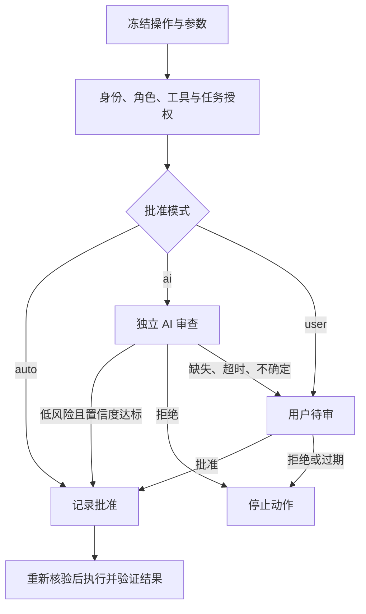

# 操作批准：自动、AI 与用户审核

## 模式和默认策略

| 模式 | 行为 | 当前默认范围 |
| --- | --- | --- |
| `auto` | 核验任务授权后，程序记录批准并执行 | 75 个候选只读工具 |
| `ai` | 独立 AI 审查器判断，符合条件才执行 | 15 个文档、任务、表格、草稿等写工具 |
| `user` | 进入用户待审队列，由任务发起人批准 | 17 个通用任务更新、创建/更新 MR、发送消息/邮件、提交日志、日程/群聊/会议、设计生成工具 |

规则在 [approvals.json](../config/approvals.json)，数量基于当前 107 个候选工具，不代表产品所有操作权限。默认 read→auto、write→user；常规写工具显式覆盖为 ai。规则可配置。

优先级：`mandatory_user_tools` 或可信适配器风险标记 → 具体工具规则 → 效果默认规则。必须用户审核的工具不能被普通 auto/ai 规则覆盖；修改该限制需要显式调整 mandatory 列表。任何风险标记（包括未知标记）都升级用户，不能用模型自述“低风险”替代适配器判断。

批准不替代身份、资源、工具白名单、Schema、任务 Grant 或调用预算，也不改变 Codex 自身的工具审批设置。



## 绑定、有效期和撤销

批准绑定用户、组织、run/task/plan、角色、技能、工具、效果、目标、完整参数摘要、逻辑动作键、任务授权 ID 和策略摘要。重试保留逻辑动作键；变更目标、参数、接收人、计划或动作键需要新批准，不能将旧批准用于另一个动作。

默认最长 15 分钟，且不超过 Grant 和运行期限。状态为 `pending / approved / rejected / expired / revoked`。拒绝或撤销后，重复 execute 不会创建另一个自动通过的请求；过期后由控制面重新签发任务授权、重新审核，不自动延长旧批准。

策略或审查指令变化会改变摘要。配置更新需重新加载全部执行器或显式替换 policy 实例，旧版本工作者应退出；尚无跨主机策略热更新服务。

## AI 审核

[审查器指令](../agents/approval-reviewer/AGENT.md) 属于无业务工具的批准组件，不增加业务角色的工具权限。

AIReview 必须匹配 approval/action/policy 标识，包含 decision、risk、confidence 和有限原因码。仅 `approve + low + confidence≥0.9 + LOW_RISK` 批准；高置信度 reject 拒绝，其他情况转用户。审核包本身也校验摘要，无法用替换后的参数批准原操作。

AI 不能批准 user 模式。缺少模型、超时、无效返回、低置信度、风险不明或原因矛盾都会升级用户。迟到结果不能覆盖过期、撤销、取消或旧计划。

**当前 AI 回调协议和判断逻辑已实现，真实模型适配器未连接**；测试和演示使用模拟审查器。独立模型调用预算、费用与供应商配置仍需接入，不将模拟结果称为真实 AI 已审核。

## 用户审核 API

1. `execute` 遇到待审操作时返回 blocked、AI_REVIEW_REQUIRED 或 USER_APPROVAL_REQUIRED，以及 approval_id；不调用业务工具，不占目标锁，不消耗工具调用预算。
2. 控制面通过 `approval_preview` 获取精确工具、目标、参数、模式和 action_digest，向有权用户展示具体影响，不能只问“是否允许 Agent 继续”。
3. `pending_for(actor_user_id=..., actor_organization_id=...)` 返回该用户在当前组织的有效用户待审项，过滤过期、已取消和旧计划。
4. 认证界面调用 `user_decide`，提交登录用户、组织、预览摘要和布尔决定。actor 身份必须来自认证会话，不能由模型填写，也不能以转发文字证明身份。
5. 批准后用原参数、原逻辑键再次 execute；批准本身不会触发业务动作。`revoke` 可撤销批准，已发往远端的操作仍需核验实际效果，不能靠撤销追回。

用户审核目前提供 **Python API，没有钉钉批准卡片、认证回调或审核页面**。接 UI 时应验证签名、身份、关联和防重放，再调用本组件；不能用 MCP 的 OA 审批接口代替本系统批准。

## 使用和存储

```powershell
python scripts/agents.py approvals
python scripts/agents.py assemble dingtalk dingtalk-scoped-write --effect write
python -m agent_runtime.demo
python -m unittest discover -s tests -v
```

装配结果逐工具标注 approval_mode，实际执行时还可能因风险标记升级。增加批准规则不会自动把白名单外的删除或权限操作加入可用工具。

SQLite 保存批准、审核事件及操作关联，不存参数正文和审查提示词。预览通过冻结参数生成，重启后的资料恢复仍需上层产物存储。`Grant` 和审核 API 属于可信控制面，不是加密令牌；模型进程不能直接获得授权签发、用户决定或数据库写权限。

本层已接入业务工具执行器。生产 MCP 适配器、本地代码执行器、模型循环及完整 DAG 仍未完成；这些组件不能绕过批准层。
