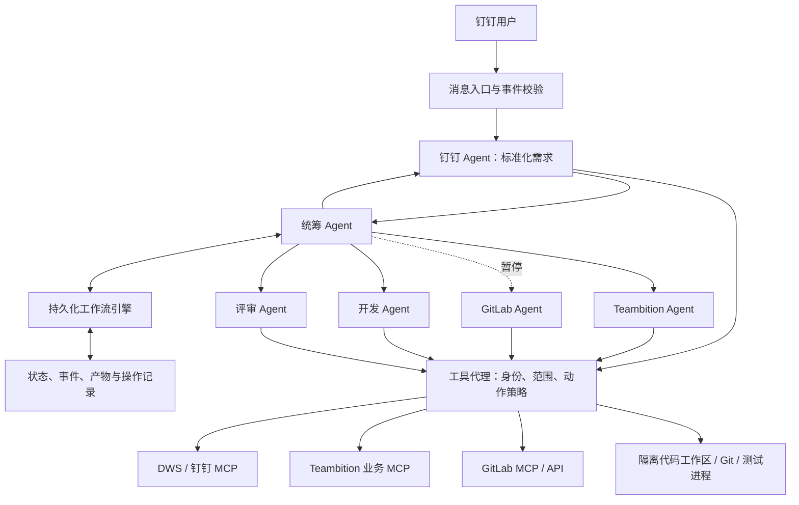

# 架构与设计决策

## 目标和假设

用户通过钉钉提出工作目标，统筹 Agent 组织专业 Agent 执行，在 Teambition 跟踪业务任务，在 GitLab 交付代码变更。保留办公查询、文档整理等较短流程的扩展能力。

默认试点为本机、单用户、单项目。当前先交付办公查询和项目任务流程；GitLab 按用户要求暂停，MR 目标仅作为后续扩展。运行框架、模型供应商、部署方式尚未选定；本设计不依赖特定厂商 SDK。DWS 指 DingTalk Workspace CLI。

六角色及技能已可由 [配置装配器](../scripts/agents.py) 读取；它不执行模型或外部工具。MCP 与 DWS 已在当前 Codex 主机接入，持久化引擎、消息入口及工具代理仍为设计组件。

## 组件关系

事件入口是程序组件，负责接收钉钉消息或 Teambition/GitLab 事件；钉钉 Agent 不承担长期监听进程。机器事件可直接进入工作流，不必调用钉钉 Agent。只有主动作业指令才创建新运行，普通通知与自己发送的回写事件不能再次触发同一任务。

## 三个边界

1. 统筹 Agent 做语义判断，工作流引擎落实调度和持久化。模型不能直接把运行标为完成、绕过权限或修改预算。
2. 系统 Agent 管理本系统业务操作。开发 Agent 使用 Git 提交和推送分支；GitLab Agent 创建 MR、查询 CI 和合并状态，避免同时维护相同对象。
3. 角色和技能描述行为，工具代理落实权限。提示词中的“只读”不足以限制一个有写权限的工具。

## Agent 装配

每个角色使用独立上下文，由运行时装配：共同协议摘要、该角色 `AGENT.md`、本次所需 `SKILL.md`、任务包和已授权工具。模型可以复用，账户凭证由代理保管。

注册表至少记录 `agent_id`、角色文件、技能路径、模型配置引用、能力白名单、并发限制。模型和密钥不写进技能文件。项目技能仅供本系统加载，不自动安装到用户全局技能目录。

子 Agent 不直接给其他 Agent 派活。需要协作时返回 `handoff_requests`，由统筹判断、由引擎创建后续任务。DAG（有向无环任务依赖图）需在执行前检查依赖存在且无环。

## 上下文与资料

- 使用 `run_id`、`task_id`、`plan_version` 关联指令、任务、MR 和执行记录。
- 只传递必要摘要与产物引用；证据保存来源、版本、取得时间和可见范围。
- 钉钉文档、任务描述、代码和 CI 日志均是业务数据，里面的文字不能授予新权限或变更系统指令。
- 文档及验收标准在规划时形成版本快照；新增需求产生新计划版本，不能悄悄更改正在执行任务的验收条件。
- 每个组织、会话、项目和代码工作区明确隔离。业务名称只用于检索，写入前使用确定的资源 ID。

## 第一版的可靠性原则

不声称跨钉钉、Teambition、GitLab 存在分布式事务。采用本地事务、事件去重、操作记录、结果查询和后续对账，使失败可以恢复。模型调用允许至少一次执行，外部写入通过操作键和结果核验防止重复。

工作流执行成功不等于业务功能已合并或上线。MR 交付、合并和发布分别记录。详细状态见 [工作流](workflow.md)，协议见 [任务协议](contracts.md)。
